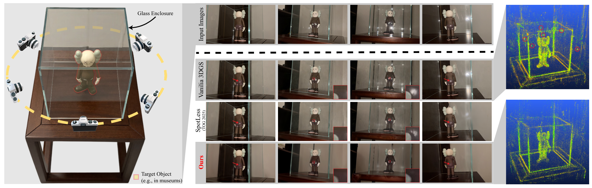
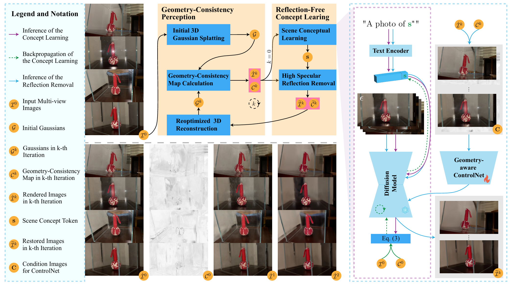

<div align="center">
<h1>
    <a href="https://aswhalefall.github.io/GlassGS/" target="_blank">
        GlassGS: Geometry and Concept-Aware 3D Gaussian Splatting for Reflective Enclosures (ECCV 26)
    </a>
</h1>


</div>

<p align="center">
  <a href="https://aswhalefall.github.io/GlassGS/"><strong>Project Page</strong></a> ·
  <a href="https://link.springer.com/chapter/10.1007/978-3-032-37432-5_7"><strong>Paper</strong></a> ·
  <a href="https://github.com/Aswhalefall/GlassGS"><strong>Code</strong></a>
</p>

<p align="center">
Mingxuan Cui · Yunrui Zhu · Wuqi Wang · Di Lin · Jianhua Zhang<br>
Jie Zhang · Ming-Ming Cheng · Shengyong Chen · Qing Guo
</p>

**[Explore the project page](https://aswhalefall.github.io/GlassGS/)** for interactive visual comparisons, our method, experiments, datasets, and citation details.

## Overview

We introduce **GlassGS**, a geometry- and concept-aware 3D Gaussian Splatting framework for reconstructing objects inside reflective glass enclosures.

High specular reflections (HSR) severely violate multi-view consistency and are easily reconstructed as false geometry. We observe two key properties:

- **Geometry-inconsistency:** reflections vary significantly across viewpoints and corrupt geometric reconstruction.
- **Concept-preservation:** despite local reflection contamination, the underlying object concept remains relatively stable.

We jointly exploit these properties to suppress reflections while preserving faithful object geometry and appearance.

<br>

<div align="center">

</div>


## 💥 News 💥
- **`18.6.2026`** | Accepted by ECCV 2026! 🎉


# Getting started (For Geometry-consistency Map)

## Requirements
Please follow the instructions from [3D Gaussian Splatting for Real-Time Radiance Field Rendering](https://github.com/graphdeco-inria/gaussian-splatting) to create a base env.

```bash
# Assuming that the base env you create names Glass3D
conda activate Glass3D
pip install tensorboard
# Note that our submodules/diff-gaussian-rasterization is different from vanilia 3DGS, you may need to install it manually using:
cd submodules/diff-gaussian-rasterization
pip install -e . 
```

## Dataset Preparation

**Example Dataset Directory Structure:**
Our dataset structure follows vanilia 3DGS as:
```
<scene_dataset_location>/
├── images/
│   ├── <image_0>
│   ├── <image_1>
│   └── ...
└── sparse/
    └── 0/
        ├── cameras.bin
        ├── images.bin
        └── points3D.bin
```

## Training for Geometry-consistency Map

**Quick Start:**
```bash
python train_with_mask.py -s [DATA_PATH] -m [OUTPUT_PATH]
```

**Output Directory Structure:**

```
<location>
├── cameras.json
├── cfg_args
├── chkpnt30000.pth
├── converted.ply
├── events.out.tfevents.xxx.xxx.xxx.x
├── input.ply
├── point_cloud
│   └── iteration_30000
│       └── point_cloud.ply
├── test
│   └── ...
├── train
│   └── ...
├── view_30000_confidence
│   ├── <image 0>
│   ├── <image 1>
│   ├── ...
├── view_30000_render
│   ├── <image 0>
│   ├── <image 1>
│   ├── ...
```
The geometry-consistency map for each viewpoint is saved in `view_30000_confidence/` using the same filename as its corresponding input image.

## High Specular Reflection Removal with Geometry-Consistency Maps

> [!NOTE]
> Our original implementation was developed with the now-deprecated runwayml/stable-diffusion-v1-5. Since the original repository is no longer available, we plan to use its community-maintained mirror, stable-diffusion-v1-5/stable-diffusion-v1-5, for future instructions. While the mirror is intended to preserve the original SD 1.5 model, minor differences in repository structure or model files may exist.

> For practical use, we recommend **Qwen-Image-Edit** as a modern alternative for reflection restoration. Specifically, the **input image and its geometry-consistency map can be concatenated as the model input**, with the consistency map serving as an explicit cue to guide the model toward restoring **low-confidence / reflection-contaminated regions** while preserving reliable regions.
>
> We plan to update the pipeline once a suitable replacement is fully validated.

### Reflection Restoration & Self-Cycling Refinement

After obtaining the restored images, organize them together with their corresponding **geometry-consistency maps** as follows:

```text
<scene_dataset_location>/
├── images/          # Original multi-view images
├── ref_image/       # Restored images
└── mask/            # Corresponding geometry-consistency maps
```

After obtaining the restored images, copy them to `ref_image/` and their corresponding geometry-consistency maps to `mask/`, ensuring that each image-map pair shares the same filename.
Then, rerun the 3DGS training pipeline with the updated scene dataset to complete one iteration of self-cycling refinement. The newly optimized 3DGS can be used to recompute geometry-consistency maps for the next restoration cycle.

## Acknowledgement

We thank the authors of the following outstanding open-source repositories for their valuable code and contributions:

- [Hugging Face Diffusers](https://github.com/huggingface/diffusers) – the foundation of our text-to-image pipeline  
- [3D Gaussian Splatting](https://github.com/graphdeco-inria/gaussian-splatting) – the foundation of our reconstruction pipeline

## Citation 

If you find our work useful, please consider citing:

```
@InProceedings{10.1007/978-3-032-37432-5_7,
author="Cui, Mingxuan
and Zhu, Yunrui
and Wang, Wuqi
and Lin, Di
and Zhang, Jianhua
and Zhang, Jie
and Cheng, Ming-Ming
and Chen, Shengyong
and Guo, Qing",
editor="Favaro, Paolo
and Kukelova, Zuzana
and Maki, Atsuto
and Rohrbach, Anna
and Schindler, Konrad
and Tombari, Federico",
title="GlassGS: Geometry and Concept-Aware 3D Gaussian Splatting for Reflective Enclosures",
booktitle="Computer Vision -- ECCV 2026",
year="2026",
publisher="Springer Nature Switzerland",
address="Cham",
pages="109--127",
abstract="Reconstructing 3D scenes of objects displayed in glass enclosures remains a significant challenge for 3D Gaussian Splatting (3DGS), particularly in museum and exhibition hall settings where transparent protective cases are ubiquitous. The high specular reflections (HSR) generated by glass surfaces severely degrade reconstruction quality, yet their underlying properties and impact on 3DGS remain poorly understood. Through systematic investigation, we reveal two insights into HSR behavior in 3DGS: (1) Geometry-inconsistency property: HSR causes 3D points to exhibit drastically different appearances across viewpoints, fundamentally violating the geometric consistency assumption that underpins 3DGS; (2) Concept-preservation property: Despite corrupting local appearance, HSR has remarkably limited influence when learning high-level object concepts, as the true object structure remains intact beneath the reflective layer. Motivated by these insights, we propose GlassGS, a geometry and concept-aware 3DGS framework with an iterative two-stage optimization. First, we compute geometry-consistency maps for each input view to evaluate the appearance variations across viewpoints, explicitly identifying HSR-affected pixels by measuring the appearance variations of 3D points across views. Second, we introduce a geometry-inconsistency-guided object concept learning module that leverages these maps to learn robust object representations while actively suppressing reflection interference. The two stages mutually reinforce each other through iterative refinement, improving both inconsistency detection and concept learning. For this new task, we collect the first dataset specifically designed for 3DGS reconstruction of glass-enclosed objects. Extensive experiments demonstrate that GlassGS significantly outperforms state-of-the-art methods, enabling high-fidelity digitization of glass-enclosed scenes and opening new possibilities for virtual museum experiences.",
isbn="978-3-032-37432-5"
}
```

